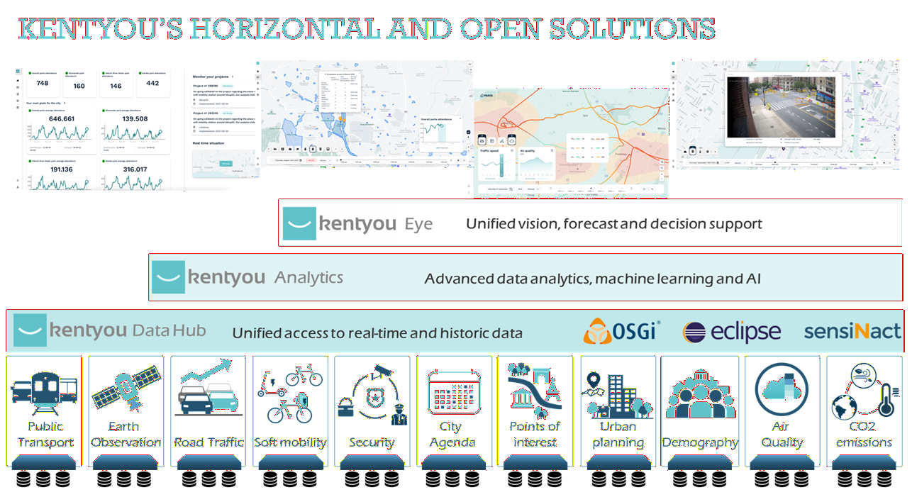
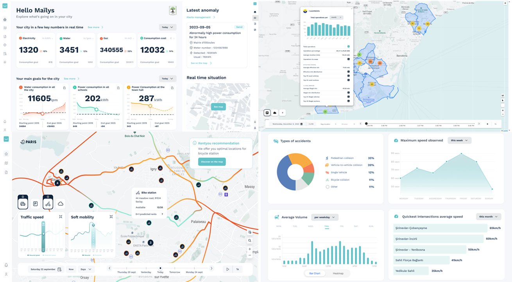
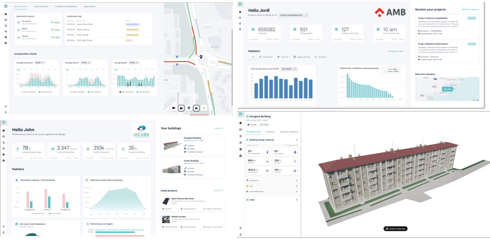
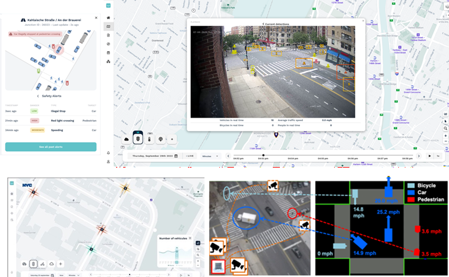
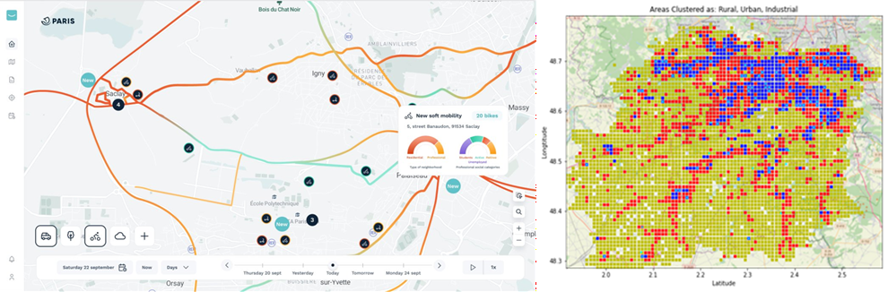
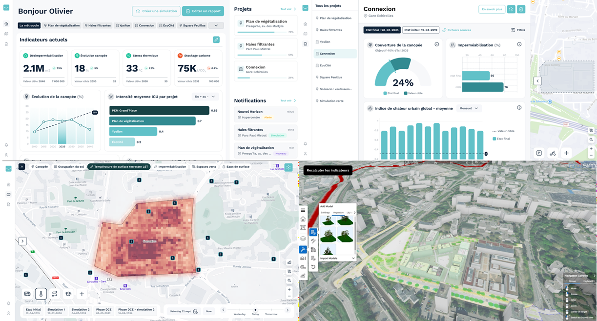
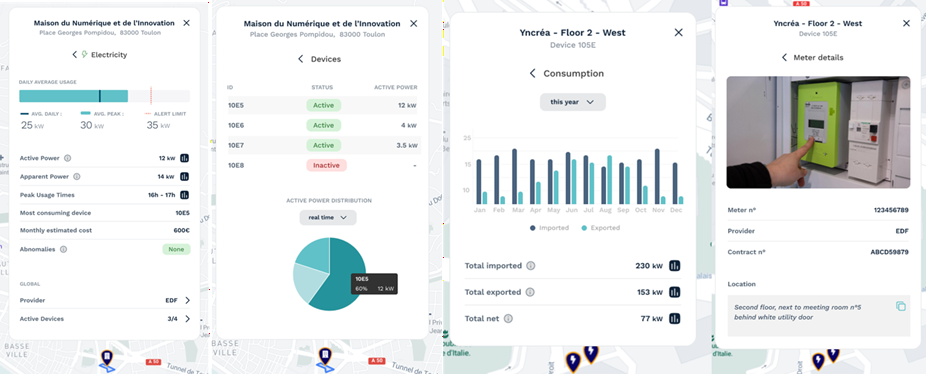

# Kentyou Eye

Kentyou Eye is a tool for monitoring and oversight of smart cities. Based upon Eclipse sensiNact and Kentyou Data Hub, it adds layers of data analytics and visualization to the data platform. Kentyou Eye integrates decision support capabilities and thus empowers city stakeholders to harness the full potential of data-driven insights, enabling informed decision-making and strategic planning.

- **Comprehensive Data Gathering**  
  Seamlessly collect and curate a diverse array of urban data sources, ensuring a holistic view of your city's dynamics.

- **Advanced Data Aggregation**  
  Merge geographic information, legacy datasets, and real-time sensor data to create a unified and comprehensive data landscape.

- **Customizable Performance Indicators**  
  Define and track mission-specific indicators in real-time, allowing for agile adaptation and proactive intervention.

Kentyou Eye emerges as the quintessential ally for city services, offering adaptive decision support tailored to each mission's unique objectives. Powered by cutting-edge data analytics, simulations, and forecasts, this dynamic tool empowers decision-makers to enact tangible transformations that change life in the city.

- **Historical Data Analysis**  
  Delve into the annals of urban history, uncovering trends and patterns that illuminate past successes and challenges.

- **Predictive Insights**  
  Peer into the future, leveraging advanced forecasting algorithms to anticipate evolutions and trends on the horizon.

- **Data-Driven Guidance**  
  Receive actionable insights and suggestions derived from comprehensive data analysis, ensuring informed decision-making at every turn.
- **Impact Anticipation**  
  Gain a comprehensive understanding of the potential ramifications of your decisions, allowing for proactive measures to mitigate risks and maximize benefits.

## Mobility Hypervisor

Efficient traffic management is a cornerstone of sustainable urban living, affecting not only mobility but also the seamless functioning of interconnected city services such as waste collection, public transportation, and emergency response. Kentyou Mobility provides a robust, city-scale solution for monitoring, analyzing, and optimizing traffic flows, empowering cities with a comprehensive decision-support system for both real-time incident management and long-term urban planning.

The Kentyou Eye software suite integrates diverse data sources, including traffic cameras, road sensors, GPS systems, and historical traffic databases, to create a unified, dynamic view of mobility across the city. By connecting to existing city infrastructure, the platform enables real-time visualization of traffic patterns, detection of anomalies, and rapid response to incidents, ensuring smooth and safe mobility.

Beyond monitoring individual intersections, Kentyou Mobility delivers advanced analytics to uncover city-wide traffic trends, origin-destination patterns, and bottleneck causes. This data-driven approach supports strategic urban planning, helping cities optimize infrastructure, coordinate with public transport schedules, and align with broader sustainability goals.

The system's interoperability extends to other city services, allowing for cross-departmental collaboration and more efficient resource allocation. For example, traffic data can inform waste collection routing, synchronize with public transport, or prioritize emergency vehicle access during peak congestion. With Kentyou Mobility, cities gain a powerful tool to enhance mobility, reduce congestion, and foster a more connected, resilient urban environment.

## AI for Soft Mobility Placement

The Soft Mobility Placement Tool is an AI-powered decision support solution designed to help cities accelerate the transition toward sustainable mobility and reduce transportation-related CO₂ emissions.The tool integrates demographic, environmental, economic, mobility, and city service data to identify optimal locations for soft mobility infrastructure such as electric vehicle charging stations, cargo bike hubs, and shared mobility services. By combining machine learning-based area characterization, geospatial analysis, and multi-criteria optimization, the tool evaluates social, environmental, and economic factors to ensure equitable access, minimize environmental impact, and respect budget constraints.

The optimisation process considers multiple criteria, including accessibility, mobility demand, fleet usage patterns, proximity to public transport and mobility hubs, land-use characteristics, and infrastructure constraints. Building upon previous research in sustainable mobility infrastructure localisation, the methodology adapts facility-location optimisation models to support strategic planning for EV charging networks and other soft mobility services. The tool generates data-driven recommendations that balance coverage, accessibility, and deployment costs while promoting social inclusion and sustainable urban development.

To support decision-making, the solution provides an interactive urban mobility dashboard that enables planners and policymakers to visualise candidate sites, compare deployment scenarios, and assess infrastructure coverage through key performance indicators (KPIs). Already validated in European cities such as Barcelona and Paris-Saclay, the platform offers actionable insights that facilitate transparent, evidence-based planning and help local authorities design mobility networks that better serve citizens while advancing environmental and climate goals.

## Climate Impact Monitoring – Urban Heat Island Mitigation

As climate change intensifies, cities face the pressing challenge of urban heat islands, which complicate urban adaptation and resilience efforts. Effective mitigation requires a deep understanding of these heat-prone areas to design environments that support sustainable and comfortable living.

Kentyou offers a powerful solution that consolidates diverse data sources—such as satellite imagery, local IoT sensor readings, and existing municipal databases—to provide a thorough analysis of urban heat islands. This solution leverages data on land use, vegetation cover, tree canopy distribution, surface temperatures, building materials, façade types, and real-time weather readings to create a robust profile of urban heat dynamics.

By aggregating this data, Kentyou enables cities to assess the risks associated with urban heat islands. The platform’s simulation tools help visualize the effects of future construction or renovation projects, allowing planners to design projects that minimize heat retention and maximize liveability. Through data-driven insights, Kentyou’s solution aids cities in transforming heat-prone areas into comfortable, climate-resilient urban spaces.

## City Energy Management

Managing energy use across a wide range of city-owned buildings—such as municipal offices, schools, and sports facilities—is essential for controlling costs and advancing the shift to carbon-neutral urban areas.

Kentyou offers a comprehensive solution that consolidates data on electricity, gas, and water consumption across all municipality-controlled buildings. With this tool, city managers can access both a high-level overview of resource use across the city and detailed, site-specific insights. These insights are available through an interactive map view or by directly searching specific meters or contract details.

The platform enables in-depth analysis of historical consumption data, comparisons, and trend identification, allowing cities to optimize energy use over time. Additionally, Kentyou’s solution includes customizable consumption alerts and tools for managing energy-related activities, making proactive management simpler. Integrated reporting functions streamline the generation of reports for city authorities, supporting transparency and informed decision-making on energy management.

